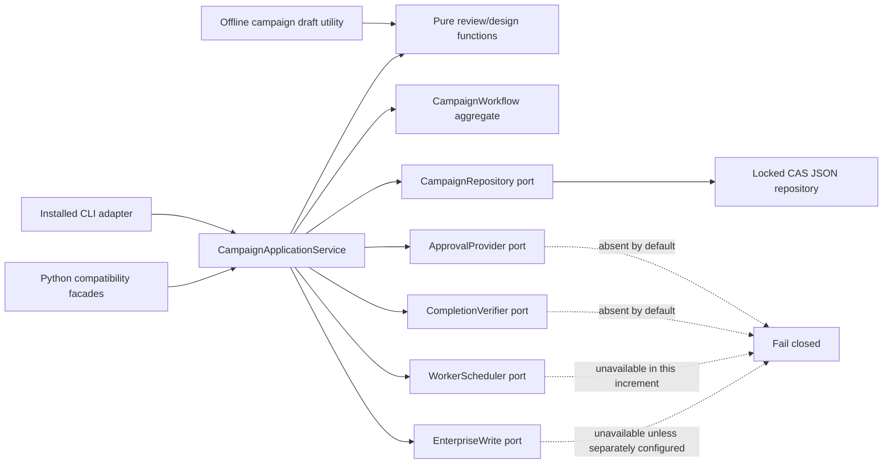

# DES-019 — Canonical campaign workflow and application service

- Document State: `DRAFT`
- Evaluation State: `IN_REVIEW`
- Artifact ID: `DES-019`
- Requirements: `PRD-001`, `REQ-001`–`REQ-009`, `REQ-012`, `NFR-001`–`NFR-004`
- Decision records: [ADR-001](ADR-001-canonical-workflow-aggregate.md), [ADR-002](ADR-002-authority-and-worker-trust-boundary.md)
- Evidence boundary: this is an implementation design. It is not approval, execution evidence, a Gate decision, or a claim that production identity or remote execution exists.

## 1. Problem and scope

QA Master currently has three overlapping paths:

1. `qa_master.core.Campaign`, used by the installed `qa-master` command, stores answers, a planning contract and free-text approvals.
2. `qa_master.workflow.Workflow` has the dependency graph, exact artifact checks, invalidation and typed completion receipts, but is not the installed command's state model.
3. `qa_master.campaign_cli` produces an offline design report without participating in either persisted workflow.

This split makes readiness, invalidation and approval semantics depend on the stateful entry point. `DES-019` defines one aggregate and one application service while retaining the existing installed command spellings as compatibility adapters. The smallest safe implementation evolves `Workflow` semantics into the canonical aggregate and converts `Campaign` into a compatibility facade; it does not merge the weaker approval behavior into the canonical model. `campaign_cli.prepare_campaign` remains a stateless draft-generation utility: it may reuse pure domain functions, but it is not another persisted workflow and does not have authority to change campaign state.

The design covers local campaign state, planning, pause/resume, change invalidation, exact decisions and typed completion. Enterprise writes and remote execution remain behind ports and default to unavailable. Production IAM, multi-user audit infrastructure and a remote scheduler are outside this implementation scope.

## 2. Required invariants

The application service must enforce these invariants for every entry point:

- one persisted state document has one schema, aggregate and revision;
- readiness is derived from the dependency graph and current bindings; callers cannot set `READY`;
- a design-only task contract can never dispatch, execute, create an external object or record an execution result;
- planning text may narrow capabilities but cannot widen a previously denied capability;
- a pause survives restart; while paused, progression mutations fail closed until an explicit resume command succeeds;
- changing a contributing answer, artifact, dependency result, scope or authorization invalidates the affected step and all descendants;
- completed work with a mismatched current binding becomes `STALE` or `NEEDS_REVALIDATION`; it is never silently reused;
- legacy free-text approvals are retained as audit assertions with `UNVERIFIED` assurance and never satisfy an approval or execution gate;
- caller-supplied reviewer names, booleans and dictionaries are not trusted approval or completion evidence;
- a side-effecting completion requires a typed receipt returned by a configured verifier and bound to the exact current completion envelope;
- process completion and business test outcome are separate. Exit code zero cannot create `PASS`;
- read-only commands do not rewrite state;
- all mutations use revision compare-and-swap and append a redacted event with a monotonic sequence number.

## 3. Logical architecture



### 3.1 Component responsibilities

| Component | Responsibility | Must not do |
|---|---|---|
| `CampaignApplicationService` | Load, authorize, execute one command, CAS-save, and return a typed result. | Parse persistence formats in command handlers; trust raw caller claims; contact an adapter for a read-only query. |
| `CampaignWorkflow` | Own task contract, dependency graph, answers, steps, approval/decision records, completions, invalidation and campaign mode. | Perform file or network I/O; verify signatures; infer business outcomes. |
| `CampaignRepository` | Detect schema, migrate in memory, load/save with revision CAS and atomic replacement. | Upgrade assurance or silently retry a conflicting mutation. |
| `ApprovalProvider` | Verify a typed approval envelope and opaque proof against configured policy. | Return a boolean; store private keys in campaign state; imply production IAM solely from a display name. |
| `CompletionVerifier` | Verify a typed completion envelope and external/local receipt. | Treat process exit as a test verdict. |
| Compatibility adapters | Preserve current installed CLI/Python call shapes and translate them to commands. | Maintain separate authoritative state or bypass service policy. |
| Offline draft utility | Produce a deterministic local draft from one bundle by calling pure review/design functions. | Persist workflow state, approve a baseline, attach evidence automatically or call side-effect ports. |

## 4. Canonical persisted schema

The schema name is `qa-master.campaign`; the first canonical version is `2`. JSON remains the local storage encoding for this increment.

```json
{
  "schema_name": "qa-master.campaign",
  "schema_version": 2,
  "campaign_id": "uuid",
  "project": "demo",
  "revision": 7,
  "event_sequence": 18,
  "mode": "ACTIVE",
  "pause": null,
  "task_contract": {
    "contract_version": 1,
    "requested_stages": ["design"],
    "no_execution": true,
    "no_external_writes": true,
    "capabilities": {
      "plan": true,
      "local_artifact_write": true,
      "execute": false,
      "external_write": false
    },
    "source_prompt_sha256": "sha256"
  },
  "answers": {},
  "steps": {},
  "approvals": {},
  "legacy_assertions": [],
  "events": [],
  "migration": null,
  "legacy_payload": null
}
```

For a migrated document, `legacy_payload` preserves the complete validated legacy JSON value, including fields not understood by v2. It is never logged. This prevents migration from silently dropping `Campaign` fields, `Workflow.Step` fields or receipt metadata while compatibility behavior is being retired.

Migration does not guess whether a legacy field contains a secret, because heuristic deletion or rejection could lose valid business data and break a faithful recovery. `legacy_payload` and the copy-once backup are therefore treated as sensitive local state: never emitted to logs, CLI output or events, and written with owner-only permissions where the host supports them. Existing legacy content is preserved, but the product does not claim that this historical content is secret-free.

### 4.1 Controlled values

- Campaign mode: `ACTIVE`, `PAUSED`, `ARCHIVED`. `ARCHIVED` is reserved until archive requirements exist.
- Persisted step status: `PENDING`, `COMPLETED`, `STALE`, `NEEDS_REVALIDATION`. `READY`, `WAITING_INPUT`, `WAITING_APPROVAL`, `BLOCKED`, and `DENIED_BY_TASK_SCOPE` are query results, not persisted status.
- Answer state: `PROVIDED`, `CONFIRMED_NONE`.
- Decision assurance: `UNVERIFIED_LEGACY`, `LOCAL_ASSERTED`, `LOCAL_SIGNATURE_VERIFIED`, `EXTERNAL_PROVIDER_VERIFIED`.
- Evidence status follows repository governance: `PENDING`, `NOT_AVAILABLE`, `NOT_EXECUTED`, `INFERRED`, `OBSERVED`, `VERIFIED`. It never uses `BLOCKED`.

### 4.2 Step record

Each step stores its definition version, dependency IDs, required answer keys, approval kinds, side-effect class, persisted status, result reference, last completion binding and optional verified receipt metadata. Definitions are copied into state so a later software upgrade cannot silently reinterpret an existing campaign. A definition upgrade is an explicit migration that invalidates changed steps and descendants.

### 4.3 Task contract monotonicity

`PlanTask` compiles text into a proposed contract. Applying it obeys:

```text
effective.execute       = current.execute       AND proposed.execute
effective.external_write = current.external_write AND proposed.external_write
```

For a new campaign the default values of both capabilities are `false`. An explicit scope-change command and verified approval are required to widen them. Until such a provider exists, the installed CLI remains `PLANNING_ONLY` and cannot widen either capability.

## 5. Application command and query contracts

All mutations carry `campaign_id`, `expected_revision` and a typed payload. Full command-level `request_id` replay protection is a target contract for the later authority/worker slice: a repeated request with the same canonical payload returns the recorded result, while reuse with different content is rejected. The current migration MVP relies on revision CAS and command-specific idempotence; it must not claim general request deduplication.

### 5.1 Commands

| Command | Main inputs | Result and rules |
|---|---|---|
| `InitializeCampaign` | project, optional state path | Creates schema v2, revision 1, default-deny contract. |
| `PlanTask` | prompt | Persists the narrowed task contract, requested steps and questions. It never widens execution/write capabilities. |
| `RecordAnswer` | key, typed value | Invalidates every step whose completion binding includes the changed answer, plus descendants. Equal values are idempotent. |
| `RequestStages` | stage IDs | Adds graph closure using the versioned step registry. It does not authorize a stage. |
| `PauseCampaign` | reason | Changes mode to `PAUSED`; records actor assertion only as metadata. It does not cancel an already dispatched operation. |
| `ResumeCampaign` | optional reason | Changes `PAUSED` to `ACTIVE`; normal readiness is re-evaluated against current bindings. |
| `RecordLegacyApprovalAssertion` | kind, text value | Compatibility-only. Stores `UNVERIFIED_LEGACY`; never changes readiness. |
| `ApproveExactArtifact` | typed envelope, opaque proof | Provider verifies the exact envelope and returns a typed verified decision. No provider means denial. |
| `CompleteStep` | step, result/evidence ref, exact artifacts/scopes, optional receipt | Non-side-effect steps require an exact current binding. Side-effect steps also require a typed verified completion receipt. |
| `Invalidate` | source kind and source ID | Invalidates the mapped step roots and descendants; retains old completion records in event history. |

### 5.2 Queries

`GetCampaign`, `GetStatus`, `GetNextActions`, `GetQuestions`, and `ListSkills` never save state. Each response includes schema version, revision, mode, task-contract capability flags and an `execution_authorized` field. In this increment that field is always `false` unless a real provider returns a current verified authorization; `READY` alone is insufficient.

### 5.3 Stable errors

Adapters expose stable error codes and non-sensitive messages:

- `STATE_CONFLICT`: revision changed; reload and let the caller decide how to merge.
- `CAMPAIGN_PAUSED`: progression command rejected.
- `TASK_SCOPE_DENIED`: task contract denies the capability.
- `INPUT_REQUIRED`, `DEPENDENCY_PENDING`, `APPROVAL_REQUIRED`: readiness constraints.
- `APPROVAL_UNVERIFIED`, `APPROVAL_STALE`, `RECEIPT_UNVERIFIED`: trust or binding failure.
- `MIGRATION_REQUIRED`, `AMBIGUOUS_SCHEMA`, `UNSUPPORTED_SCHEMA`: persistence boundary.
- `OPERATION_STATE_UNKNOWN`: remote effect may have occurred; do not retry automatically.

Errors must not contain tokens, raw proofs, authorization headers, full sensitive payloads or presigned URLs.

## 6. State transitions, pause and invalidation

### 6.1 Campaign mode

```text
ACTIVE --PauseCampaign--> PAUSED --ResumeCampaign--> ACTIVE
```

While `PAUSED`, read-only queries are allowed. `ResumeCampaign` and an idempotent repeat of `PauseCampaign` are the only state-changing commands. Planning, answer changes, approvals, completions and dispatches return `CAMPAIGN_PAUSED`. Loading a paused campaign never resumes it.

If a future remote operation is already dispatched, pausing the campaign records `PAUSED_WITH_ACTIVE_OPERATION` in the query projection. Cancellation is a separate worker command and acknowledgment; campaign pause cannot claim that a remote process stopped.

### 6.2 Invalidation algorithm

Evaluation is recursive. Before a step may report `COMPLETED` or `READY`, the aggregate validates every ancestor in topological order against that ancestor's current binding. A stale ancestor invalidates its descendants even when the descendant's locally stored digest has not yet been queried.

Each completion binding contains digests of:

- the step definition version;
- required answers;
- exact input artifacts and scopes;
- accepted approval/decision records;
- dependency result refs, bindings and verified receipt metadata;
- task-contract capability subset relevant to that step.

On `RecordAnswer`, artifact replacement, decision replacement, task-contract change or step-definition migration, recompute the current binding. If it differs, mark the step `STALE`, clear its active result pointer and active receipt pointer, then walk descendants in topological order. Prior results and receipts stay referenced in immutable events for audit; they are not deleted or silently reattached.

## 7. Approval and completion contracts

### 7.1 Exact approval envelope

An approval provider receives a canonical envelope containing at least:

```text
schema_version, decision_id, campaign_id, project, kind, action,
scope, artifact_sha256, contributing_state_sha256, risk_class,
issued_at, expires_at, nonce, idempotency_key
```

It returns a `VerifiedApproval` value containing provider ID, provider decision ID, assurance, subject reference, issue/expiry time, binding SHA-256 and a non-secret proof reference. The aggregate validates exact binding and expiry again. A raw `reviewer` string is display metadata only.

`LOCAL_ASSERTED` may be retained for a local draft review trail, but it cannot authorize execution, an external write, defect closure, release or acceptance. Side effects require `LOCAL_SIGNATURE_VERIFIED` or `EXTERNAL_PROVIDER_VERIFIED` plus policy acceptance for the action and target.

### 7.2 Typed completion receipt

The service builds the completion envelope; callers cannot choose its fields. It includes campaign and step identity, aggregate revision, result/evidence ref and digest, artifacts/scopes/answers/approvals/dependency digests, operation ID, target/environment/build identity and the effective task-contract digest.

`CompletionVerifier.verify(receipt, envelope)` returns `VerifiedCompletionClaim` or rejects. A valid claim includes provider ID, receipt ID, issuer subject, issue/expiry time, exact binding digest, evidence ref/digest, operation ID and process state. Business outcome remains separately imported and verified. A boolean, free-form dict or the presence of a result path never completes a side-effecting step.

## 8. Schema migration and compatibility

### 8.1 Format detection

The repository detects formats by exact structural markers:

| Input | Detection | Migration treatment |
|---|---|---|
| Canonical v2 | `schema_name=qa-master.campaign`, `schema_version=2` | Validate exact shape and load. |
| Legacy `Campaign` | top-level `name`, `known`, `history`; no schema name | Answers and task contract migrate; all approval strings become `legacy_assertions` with `UNVERIFIED_LEGACY`. |
| Legacy `Workflow` | top-level `project`, `steps`, `answers`, `events`; no schema name | Graph/results migrate. Caller-created approval records become at most `LOCAL_ASSERTED`. Every completion that depends on a downgraded approval or receipt becomes `NEEDS_REVALIDATION`, including non-side-effect baselines; its descendants cannot remain completed. |
| Unknown/future | none of the above, or schema version greater than supported | Reject with `UNSUPPORTED_SCHEMA`; do not rewrite. |

Legacy format detection must match exactly one validated shape. An object matching both legacy marker sets, a partial mixture, or neither complete validator returns `AMBIGUOUS_SCHEMA` or `UNSUPPORTED_SCHEMA` and leaves the source bytes unchanged; detector ordering must never choose one interpretation silently.

Migration is deterministic, pure and covered by golden fixtures. It records source format, source SHA-256, tool version and warnings. The canonical `campaign_id` is UUIDv5 over a fixed QA Master namespace plus source format and source SHA-256, so repeated read-only projections are stable and do not depend on a mutable display name. A wall-clock migration time is added only when v2 is actually persisted; it is not part of the pure in-memory result.

### 8.2 Save and rollback behavior

Read-only commands migrate in memory and do not rewrite the file. On the first successful mutation:

1. acquire the existing state lock;
2. verify the source revision and source digest;
3. create a same-directory, copy-once legacy backup with restrictive permissions where supported;
4. atomically save canonical v2 at `revision + 1`;
5. retain the backup path and digest in migration metadata, without secrets in logs.

The repository exposes distinct operations rather than overloading revision zero:

- `create_if_absent(path, document)` holds the lock and rejects any existing file, including a revisionless legacy file;
- `migrate_existing(path, source_sha256, expected_revision, document)` requires the source to exist and verifies both digest and revision under the same lock;
- `save_existing(path, expected_revision, document)` accepts canonical v2 only and rejects a missing file.

This distinction closes the current ambiguity where `expected_revision=0` could mean either “create a new document” or “overwrite a revisionless legacy document.”

There is no dual write. Rollback to the legacy executable reads the backup; automated downgrade is allowed only before any post-migration mutation beyond the migration transaction. Otherwise a downgrade could discard decisions and invalidations, so the tool must refuse and require an explicit export/review procedure.

### 8.3 CLI compatibility

The installed `qa-master` entry point and current arguments remain accepted:

- `init`, `plan`, `answer`, `check`, `invalidate`, `status`, `skills` delegate to the application service;
- legacy `approve KIND VALUE` records an unverified assertion and clearly returns `RECORDED_UNVERIFIED`; it never makes a step ready;
- later exact approval/completion commands will consume typed JSON files or provider references, avoiding secrets on argv; these commands and a production provider are outside the current migration MVP;
- `python -m qa_master.campaign_cli` remains a stateless offline draft utility. Its report keeps `execution=NOT_AUTHORIZED` and `formal_baseline_approved=false`. A future explicit `AttachDraftArtifact` command may link its digest to a campaign, but draft generation itself does not open or mutate campaign state.

Compatibility covers command spelling and data preservation, not retention of unsafe legacy authorization effects.

## 9. Quality attributes

### Correctness and consistency

- Aggregate invariants are checked before save; schema validation rejects extra/incorrectly typed security fields.
- CAS prevents silent lost updates. Current commands provide only their documented command-specific idempotence; general request-ID/payload replay protection is a later target.
- The dependency graph is acyclic and versioned; cycle detection fails startup/migration.

### Performance, capacity and scalability

- Target local capacity: 10,000 requirements/cases, 100 workflow steps and 100,000 compact events per campaign; exact limits must be measured before release.
- Binding digests are linear in referenced metadata. Raw evidence is stored outside campaign state and referenced by digest.
- JSON is acceptable for one local writer and bounded state. Multi-user or high-event-volume operation requires a repository implementation such as a transactional database; it is not implied by this design.

### Reliability and failure modes

- Atomic replace plus fsync and revision CAS remain mandatory.
- A crash before replace leaves the old revision; a crash after replace yields the new complete document.
- Provider timeout or malformed response denies the command without changing aggregate state.
- After an irreversible remote call with no receipt, record `OPERATION_STATE_UNKNOWN`; never retry automatically. Reconciliation is a separate authorized action.

### Security and privacy

- Newly initialized state stores references, digests and non-secret audit metadata; no token, cookie, password, private key or raw detached proof. Migrated legacy payload/backups may contain historical sensitive values, so they receive restricted local handling and are never rendered or logged; preservation is not a claim that they satisfy current secret-storage policy.
- Provider and worker endpoints require explicit configuration and are absent by default.
- Command-line arguments must not carry secrets. Secret material is obtained by an external broker/provider at use time.
- Canonical JSON uses UTF-8, sorted keys, no NaN, typed identifiers and explicit size limits.

### Compatibility and maintainability

- Public adapters are thin; policy exists only in the application service and aggregate.
- `Campaign` and `Workflow` facades are deprecated after migration but tested until a documented removal version.
- Schema and step-definition versions are independent, so graph changes do not masquerade as storage changes.

### Observability

Every mutation event contains event sequence, command type, revision before/after, campaign ID, affected step IDs, provider/receipt IDs where present, redacted binding digests and result status. A request ID is included only for later commands that implement the replay contract. Logs exclude raw prompts when configured as sensitive, secrets, proofs, legacy payloads and full external payloads. Metrics distinguish planning, authorization denial, dispatch, process completion, evidence verification and business outcome.

### Deployment, upgrade and data lifecycle

- Ship the v2 reader/migrator before making v2 the default writer.
- Keep the copy-once legacy backup through the declared rollback window; expiry/deletion requires an operator action and documented retention policy.
- Evidence retention is independent from campaign state. Deleting evidence changes the linked evidence status to `NOT_AVAILABLE`; it must not rewrite historical results as verified.

### Testability

Ports accept deterministic fakes. Clock, UUID generator, repository, approval provider and completion verifier are injected. Migration tests use committed redacted fixtures. Network and process execution are absent from aggregate tests.

## 10. Current implementation increment

The current MVP is deliberately bounded. It does **not** implement production authority, remote workers, enterprise dispatch, a general command-idempotency ledger or removal of the legacy Python APIs.

It must deliver:

1. one schema-v2 state file and application service used by the installed `qa-master` entry point;
2. deterministic legacy `Campaign` and `Workflow` migration with `legacy_payload`, source digest and no approval-assurance upgrade;
3. persistent pause/resume, design-only scope retention, dependency evaluation and recursive stale detection;
4. first-write CAS migration with copy-once source backup, unknown/future-schema rejection, and lock-protected create-if-absent initialization;
5. command-spelling compatibility for the installed CLI;
6. deprecated but passing `core.Campaign` and `workflow.Workflow` library APIs for existing callers;
7. preservation of current exact-approval and typed-receipt metadata. Preservation is not re-verification or a production trust claim.

`ApprovalProvider`, stronger verified-approval types, general request deduplication, remote-worker messages and enterprise-operation integration remain later slices governed by ADR-002. They must not block acceptance of this local migration MVP, and the MVP must not claim they are present.

## 11. MVP acceptance tests

The sole `TC-SM` case contract is [DOC-SCHEMA-MIGRATION-TEST-PLAN-001](../verification/schema-migration-test-plan.md), cases `TC-SM-001` through `TC-SM-013`. This design does not redefine those stable IDs. The cases collectively cover canonical round trip, complete legacy preservation and idempotence, default-deny migration, pause/resume, concurrent writes, Unicode CLI transport, unified routing, malformed/unknown schema, read-only byte preservation and safe init, direct and recursive invalidation, side-effect denial, recovery and secret non-disclosure.

The test plan is `DRAFT / NOT_EVALUATED`; its existence is not a result. If implementation changes an interface described here, the architect and tester must reconcile the plan without weakening its observable oracles before execution.

## 12. Target architecture acceptance tests

These tests apply to later slices and are not current MVP completion criteria.

| Test ID | Scenario | Required result |
|---|---|---|
| TC-DES-001 | Migrate a legacy `Campaign` containing requirements/cases/execution free-text approvals. | Values are preserved under `legacy_assertions`; every migrated assurance is `UNVERIFIED_LEGACY`; execution remains denied. |
| TC-DES-002 | Migrate a legacy `Workflow` with a side-effect step marked done and a stored receipt-shaped dict. | Step is `NEEDS_REVALIDATION`; no new step depends on it as trusted evidence. |
| TC-DES-003 | Run `plan "只生成测试用例，不执行测试"`, reload and query execution. | Contract retains both denies; query is `DENIED_BY_TASK_SCOPE`; no execution-result event exists. |
| TC-DES-004 | Plan design-only, then plan text requesting execution. | Second plan cannot widen capability; explicit scope-change authorization is required. |
| TC-DES-005 | Pause, restart, answer a question, then resume. | Paused reload persists; answer is rejected without revision change; resume succeeds by CAS. |
| TC-DES-006 | Complete baseline, then change a contributing requirement artifact. | Baseline and descendants become stale; unrelated upstream completion remains intact. |
| TC-DES-007 | Use legacy `approve execution v1`. | Command is accepted for compatibility, records `RECORDED_UNVERIFIED`, and does not change readiness. |
| TC-DES-008 | Provider returns boolean or a typed approval bound to another target. | Both fail closed without state mutation. |
| TC-DES-009 | Completion verifier returns a valid type with a mismatched evidence ref, expired time or binding digest. | Completion is denied without state mutation. |
| TC-DES-010 | Two services mutate the same revision. | One save succeeds; the other receives `STATE_CONFLICT`; no silent merge occurs. |
| TC-DES-011 | Read-only status/check on legacy state. | Output uses canonical projection but original file and modification time remain unchanged. |
| TC-DES-012 | Crash/fault injection before and after atomic replace. | Repository loads either the complete old or complete new revision, never partial JSON. |
| TC-DES-013 | Offline campaign compatibility command. | Draft artifact is produced and returned without opening campaign state; it states unapproved/not authorized and no external port is called. |
| TC-DES-014 | Process receipt reports success with unassessed business result. | Step may record process evidence only; no test `PASS` or release decision is inferred. |

## 13. Developer-ready implementation slices

1. **MVP — canonical data and migration:** add schema-v2 types, exact validation, pure legacy migrators, complete `legacy_payload`, deterministic UUIDv5, and repository backup/CAS/create-if-absent tests. No adapter calls.
2. **MVP — aggregate service and CLI:** use the application service for the installed CLI; implement pause/resume and recursive stale evaluation; preserve `Campaign`/`Workflow` as deprecated library compatibility surfaces. Keep `campaign_cli` stateless.
3. **MVP — independent verification:** execute `TC-SM-001`–`TC-SM-013` from `DOC-SCHEMA-MIGRATION-TEST-PLAN-001`, existing regression and packaging tests under tester ownership; then perform independent review.
4. **Later — trust ports:** implement typed approval/completion protocols and fakes without enabling production side effects by default.
5. **Later — remote/enterprise integration:** implement worker and write-operation state machines only after the deferred requirements in ADR-002 are resolved.

Each slice must update the RTM and current evidence with the exact revision. No slice may convert the current V1 evaluation or any Gate to `PASS` without the required independent evidence and human decision.

## 14. Dependencies and blocking ambiguities

- Product requirements do not define a production identity provider, identity lifecycle, signing authority, revocation SLA, audit retention period or multi-user tenancy model. Production approval remains unavailable until those decisions are made.
- Remote protocols lack target inventory ownership, transport choice, worker bootstrap, isolation level, heartbeat/cancel SLA, artifact retention and disaster-recovery requirements. Only the port and message contract can be designed now.
- The maximum supported campaign/event sizes and migration rollback window lack approved product limits. The capacity figures in this document are design targets requiring measurement and product confirmation.
- Human approval of the inferred requirement baseline is absent. This document stays `DRAFT / IN_REVIEW` and does not create that approval.
